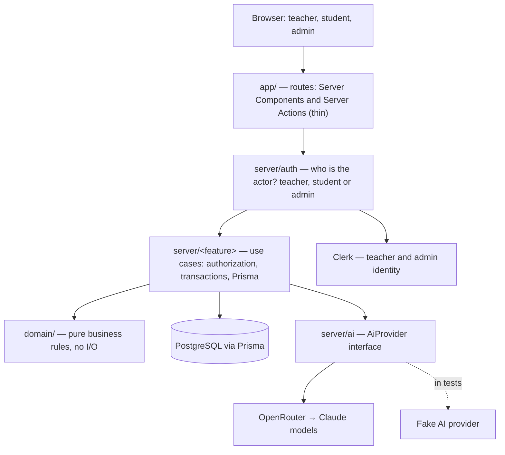
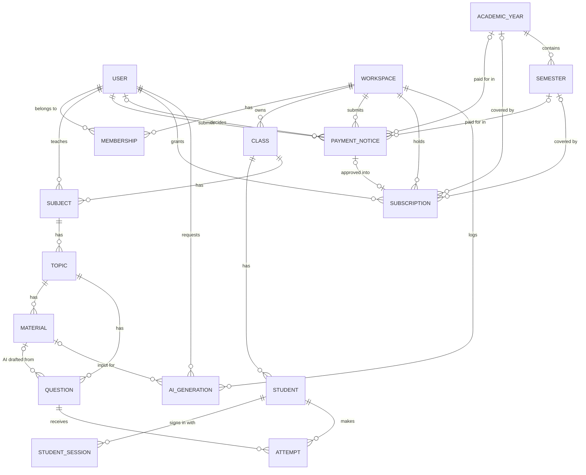
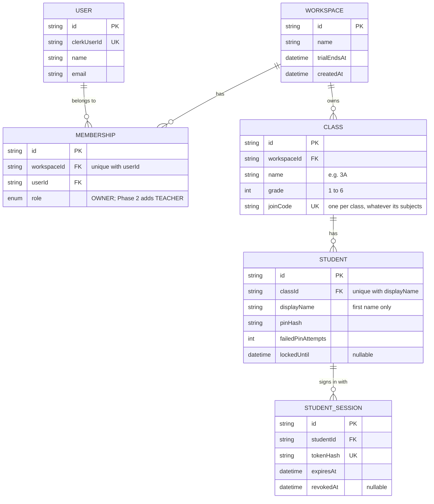
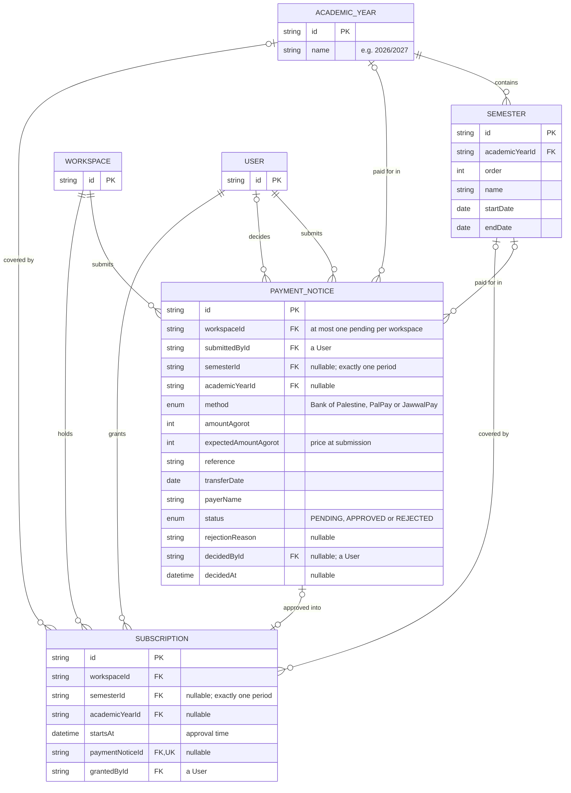
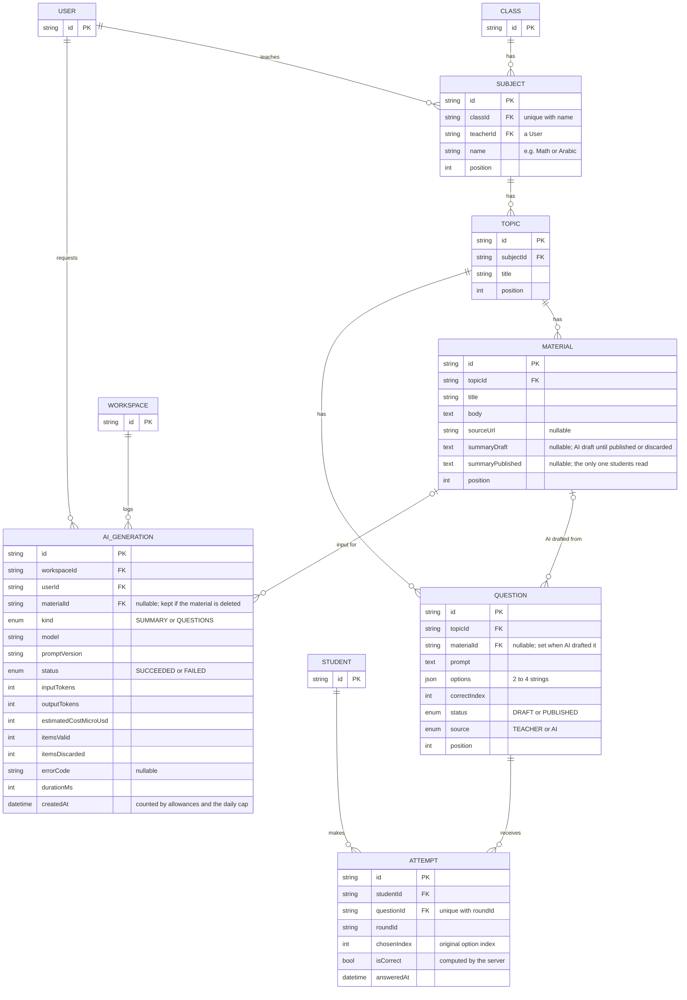

# Darsi (دَرْسي) — Architecture and Data Model

> Status: **✅ Approved (v2)** · 2026-11-22
> v2 applies the corrections from the first review and decisions D-19 to D-23. Changes from here on are logged as new decisions, and during implementation as ADRs that supersede earlier ones.
> Scope: [01-mvp-scope.md](01-mvp-scope.md) · Decisions: [../PLAN.md](../PLAN.md)

## 1. Goals that shape the architecture

1. **Business rules are easy to test.** Access, subscription periods, AI quota, practice selection, mastery and PIN lockout are pure functions with no database or clock inside them.
2. **Tenant isolation can't be forgotten.** Every query is scoped by the signed-in actor's workspace or class, and tests try to break that.
3. **Light on low-end phones.** Server-rendered pages, very little client JavaScript, Arabic right-to-left from day one.
4. **Small and boring.** One deployable app, one database, no queues or extra services in Phase 1.
5. **Ready for Phase 2 without a rewrite:** school workspaces, receipts, notifications.

## 2. Tech stack

| Concern | Choice | Why |
|---|---|---|
| Framework | **Next.js 16 (App Router)**, React 19, TypeScript in strict mode | Your core stack; Server Components keep client JavaScript small |
| UI | **Tailwind CSS v4** + **shadcn/ui** (Radix primitives) | Accessible components that we own; direction-aware utility classes (`ms-*`, `pe-*`) for right-to-left |
| Arabic font | **IBM Plex Sans Arabic** via `next/font`, self-hosted | Clear for children, supports diacritics, no request to an external font server |
| Validation | **Zod**, shared by forms, server actions, environment config and AI output | One schema per shape, checked at every boundary |
| Mutations | **Server Actions** + `useActionState` | No hand-written API layer; no heavy form library on low-end phones |
| Database | **PostgreSQL** + **Prisma** | Your core stack; relational data with strong constraints |
| Database hosting | **Neon** (Phase 1 on the free tier), in **Frankfurt** (`eu-central-1`, section 10) | It sleeps when idle and **wakes automatically**, so the demo never shows a paused database to a reviewer (Supabase's free tier pauses after a week and needs a manual restart). Pilot: Neon paid or Supabase Pro, both already in the cost estimate |
| Teacher and admin login | **Clerk** (free up to 50,000 retained users) | Secure sign-up, sign-in and password reset without building them; Arabic localization available. A Clerk production instance needs a domain we own, so the demo runs on our own domain (D-20) |
| Student login | **Our own**: class code + name + PIN, database sessions | Children have no email; see section 6 |
| AI | **Claude models through OpenRouter** (D-23): one API key, the model chosen by a setting, requests pinned to Anthropic as the serving provider. **Structured outputs**, validated with Zod | See section 7 |
| Hosting | **Vercel**: Hobby for the Phase 1 demo (non-commercial), Pro for the pilot. Functions run in **Frankfurt** (`fra1`), next to the database | Preview deployment for every PR, which reviewers and CodeRabbit can open |
| Error tracking | Server-side error tracking (e.g. **Sentry**, free tier) plus structured logs from server code. The exact tool is picked in the repo setup step | Errors in Server Actions and AI calls are visible without digging through raw logs; nothing is added to student pages (section 9) |
| Local and CI database | PostgreSQL in **Docker** (Docker Compose locally, a service container in GitHub Actions) | Tests run against real Postgres, not mocks |
| Tests | **Vitest** (unit and integration), **Playwright** (E2E) | Details in the testing strategy step |

## 3. Architecture style: modular monolith with a pure domain core

One Next.js app, organized in layers where dependencies only point inward:

| Layer | Responsibility | May import | Tested with |
|---|---|---|---|
| `app/` | Pages, layouts, Server Actions. Parse input, call one use case, render | `server/`, `ui/` | E2E |
| `server/auth` | Resolve the actor from the Clerk session or the student cookie; reject otherwise | Clerk, Prisma | Integration |
| `server/<feature>` | Use cases: check permissions and access, run the transaction, call the domain | `domain/`, Prisma, `server/ai` | Integration (real Postgres) |
| `domain/` | Pure functions: rules and calculations. Time (`now`) and randomness (`rng`) are passed in | Nothing with I/O | Unit (Vitest) |
| `server/ai` | AI provider interface, OpenRouter implementation, fake implementation, prompts | OpenRouter client, `domain/` | Unit + integration with the fake |

**Rule enforced by lint:** `domain/` must not import Prisma, Next.js, Clerk or the AI SDK. The full folder layout is part of the repo setup step.

**Route groups:** student, teacher and admin pages live in separate route groups (`app/(student)`, `app/(teacher)`, `app/(admin)`), each with its own layout. Clerk is loaded only in the teacher and admin layouts, so student pages never download it (section 9).

### Domain modules (pure, unit-tested)

| Module | Responsibility |
|---|---|
| `access` | Given the trial, subscriptions, calendar and `now`: can the teacher edit? use AI? when does access end? A subscription gives access from its `startsAt` or its period's window start, whichever is later, until the period's end (D-19) |
| `payment-notice` | Allowed state changes: only Pending → Approved or Rejected; a rejection needs a reason |
| `ai-quota` | Find the allowance window that applies now and count what's left. A paid allowance counts from approval or its window's start, whichever is later, and replaces the trial's from approval (D-19). Also checks the daily cap across all workspaces (D-21) |
| `ai-output` | Two Zod schemas for AI responses: a loose, shape-only schema sent to the API, and a strict schema that checks each item (section 7). Keep valid items, discard and count invalid ones. A response with no valid items is a failed generation |
| `practice` | Pick up to 5 questions (never answered → last answered wrong → oldest), shuffle options with an injected random source; each option keeps its original index |
| `mastery` | Mastery per topic, 0–3 stars, and the class's "needs review" topics |
| `pin` | Lockout after 5 failures for 15 minutes; reset on success |
| `join-code` | Generate class codes from an alphabet without look-alike characters; match typed codes case-insensitively |
| `digits` | Convert Arabic-Indic (٠–٩) and Persian (۰–۹) digits in typed input (PINs, class codes) to 0–9; format numbers for display (section 8) |
| `money` | Amounts as whole agorot; formatting in ILS |

## 4. Data model

### Entity relationships

The overview shows every table and relationship. The three diagrams after it add every field, grouped like the tables below. Every table has an `id` primary key (cuid2); a table drawn with only its `id` is shown in full in another diagram. `UK` marks a unique field, and "unique with" marks a unique pair. `"CLASS"` is quoted because `class` is a reserved word in Mermaid.

#### Overview

#### Identity, tenancy and students

#### Calendar and billing

#### Subjects, content, practice and AI usage

### Tables

**Identity and tenancy**

| Table | Key fields | Notes |
|---|---|---|
| `User` | `clerkUserId` (unique), `name`, `email` | A copy of the Clerk identity, so pages such as the admin's notices list can show names without calling Clerk for every row. Created on first sign-in and updated when the name or email in Clerk changes (section 5). Passwords and sessions stay in Clerk |
| `Workspace` | `name`, `trialEndsAt`, `createdAt` | The tenant. Phase 2 adds `type` (Teacher or School) |
| `Membership` | `workspaceId`, `userId`, `role` | Unique per workspace and user. Phase 1 has only `OWNER`; Phase 2 adds `TEACHER` (D-13) |

**Calendar and billing**

| Table | Key fields | Notes |
|---|---|---|
| `AcademicYear` | `name` (e.g. "2026/2027") | The year's dates come from its semesters |
| `Semester` | `academicYearId`, `order`, `name`, `startDate`, `endDate` | Postgres `date` columns, with no time part. The domain handles them as plain `YYYY-MM-DD` values, and one helper turns an end date into the end of that day in Palestine time (section 8) |
| `PaymentNotice` | `workspaceId`, `submittedById`, period (`semesterId` **or** `academicYearId`), `method` (Bank of Palestine, PalPay, JawwalPay), `amountAgorot`, `expectedAmountAgorot`, `reference`, `transferDate`, `payerName`, `status`, `rejectionReason`, `decidedById`, `decidedAt` | `expectedAmountAgorot` saves the price at submission, so later price changes don't rewrite history. **At most one pending notice per workspace**, enforced by a partial unique index in a SQL migration. "Exactly one period" is a database check constraint, as on `Subscription` |
| `Subscription` | `workspaceId`, period (`semesterId` **or** `academicYearId`), `startsAt`, `paymentNoticeId` (optional, unique), `grantedById` | Points to the period instead of copying dates, so calendar changes apply automatically (D-14). `startsAt` is the approval time; access runs from `startsAt` or the period's window start, whichever is later (D-19). `paymentNoticeId` is optional so Phase 2 can grant free or sponsored periods. "Exactly one period" is a database check constraint |

**Classes and content**

| Table | Key fields | Notes |
|---|---|---|
| `Class` | `workspaceId`, `name` (e.g. "3A"), `grade` (1–6), `joinCode` (unique) | **A group of children**, not a subject (D-22). One roster, one join code and one PIN per child, however many subjects the class has |
| `Subject` | `classId`, `teacherId`, `name` (e.g. Math, Arabic), `position` | One subject taught to a class, with its own topics. Unique per class and name. `teacherId` is the owner in Phase 1 and the assigned subject teacher in Phase 2, so one class can have several teachers while each child keeps one login |
| `Student` | `classId`, `displayName`, `pinHash`, `failedPinAttempts`, `lockedUntil` | Unique per class and name. First name only, nothing else |
| `StudentSession` | `studentId`, `tokenHash` (unique), `expiresAt`, `revokedAt` | The cookie's token is looked up by its hash. Revoked when the teacher resets the PIN |
| `Topic` | `subjectId`, `title`, `position` | Ordered units within a subject |
| `Material` | `topicId`, `title`, `body`, `sourceUrl`, `summaryDraft`, `summaryPublished`, `position` | Two separate fields, so an unreviewed summary can never reach students (D-08). The AI writes only to `summaryDraft`. Publishing copies the draft to `summaryPublished` and clears the draft; discarding just clears it. A summary the teacher writes goes straight to `summaryPublished`, like teacher-written questions. Students only ever read `summaryPublished`, so regenerating never changes what they see |
| `Question` | `topicId`, `materialId` (when drafted by AI; cleared if the material is deleted), `prompt`, `options` (2–4 strings), `correctIndex`, `status` (draft, published), `source` (teacher, AI), `position` | Options are stored as a validated JSON array: simple, and editing a question never breaks history (see `Attempt`) |

**Activity**

| Table | Key fields | Notes |
|---|---|---|
| `Attempt` | `studentId`, `questionId`, `roundId`, `chosenIndex`, `isCorrect`, `answeredAt` | **Unique per `roundId` and `questionId`**, so a retried or double-tapped answer is saved once, and a question can't be answered again in the same round after its feedback is shown. `chosenIndex` is the option's original index, not its shuffled position. `isCorrect` is computed by the server and saved at answer time, so editing a question later doesn't change past results. `roundId` groups a practice round without a separate table. Indexed by student, question and time for selection and mastery |
| `AiGeneration` | `workspaceId`, `userId`, `materialId` (cleared if the material is deleted), `kind` (summary, questions), `model`, `promptVersion`, `status` (succeeded, failed), `inputTokens`, `outputTokens`, `estimatedCostMicroUsd`, `itemsValid`, `itemsDiscarded`, `errorCode`, `durationMs`, `createdAt` | The usage log and the source for quota counting. Only successful generations count, by `createdAt`. Indexed by workspace and time for allowances, and by time for the daily cap. Deleting a material keeps its rows, so deleting content never gives AI allowance back |

### Data rules

- **Money** is stored as whole **agorot** (integers). There are no floating-point amounts anywhere.
- **IDs** are random strings (cuid2), never sequential numbers in URLs.
- **Deletes:** Phase 1 deletes content (topics, materials, questions) normally. Deleting a material keeps the questions drafted from it and its AI usage rows: their `materialId` is cleared (`SET NULL`), so published questions don't vanish and deleting content never gives AI allowance back. Deleting classes, students and accounts is a Phase 2 pilot blocker and will be designed with data export.
- **Calendar periods in use can't be deleted:** a semester or school year with payment notices or subscriptions is protected by `RESTRICT` foreign keys. The admin changes its dates instead, which moves access for everyone who paid for it (D-14).
- Constraints Prisma can't express, such as partial unique indexes and check constraints, live in **hand-written SQL migrations**, each with a test.

## 5. Key flows

**Teacher first sign-in.** Clerk signs the teacher in. On the first request, `ensureWorkspace()` creates `User`, `Workspace` (trial ends in 14 days) and `Membership` in one transaction. Two requests can run it at the same moment, for example a page load and a prefetch. The unique `clerkUserId` stops duplicates, and the request that loses the race catches the duplicate-key error and reads the records the other request created. There's no Clerk webhook, so there's no webhook endpoint to secure and test.

**Keeping the `User` copy current.** Clerk's session token is configured to carry the teacher's name and email. On each request, `server/auth` compares them with the `User` row it already loads, and updates the row when they differ. That costs no extra call to Clerk, and a change made in Clerk shows up in Darsi within about a minute, when the session token next refreshes.

**Student login.**
1. The student enters the class code, and the server finds the class.
2. The server shows the class's first names; the student picks one and enters the PIN.
3. The `pin` domain module decides whether the student is locked out.
4. The server checks the PIN hash, creates a `StudentSession`, and sets a secure HTTP-only cookie containing a random token. Only the token's hash is stored.

**Answering a practice question.**
1. When a round starts, the server picks the questions with `practice`, creates a random `roundId`, and sends each question's options shuffled. Each option keeps its original index.
2. The browser sends the `roundId`, the question ID and the original index of the chosen option.
3. The server checks that the question is published and belongs to the student's class, computes `isCorrect`, and saves the `Attempt`. If that question was already answered in this round, it returns the saved result instead of adding a row.
4. The response includes the correct option, which the screen shows as feedback.

**Approving a payment.** In one transaction:
- The notice is updated to Approved **only if it is still Pending**, which is safe against double clicks and two admins.
- The `Subscription` is created with `startsAt` set to now. Access begins now, or when the period's window starts if that's later (D-19).

The teacher's access is recalculated on their next request.

**AI generation.**
1. Check access with `access`, then check the remaining allowance and the daily cap with `ai-quota`.
2. Call the AI provider with the material text, the grade and the subject name (max ~6,000 characters).
3. Check each item with `ai-output`, and save the valid ones as **drafts**. A response with no valid items is a failed generation.
4. Log an `AiGeneration`. Errors, timeouts and refusals are logged as failed and don't use the allowance.
- Two simultaneous requests at the very end of an allowance or the daily cap can go one over. That's accepted and documented rather than adding locking.

**Access check.** Every teacher mutation runs `getAccess(trial, subscriptions, calendar, now)`. Student pages never check billing, because students always keep access.

**Demo sign-in and nightly reset (D-20).**
1. While the demo setting is on, the landing page shows "Try as teacher" and "Try as admin".
2. The server creates a short-lived Clerk sign-in token for the matching demo account (user IDs from configuration) and sends the browser to Clerk to finish signing in with it. Demo accounts have no password, so Device Trust doesn't apply and there's nothing for a visitor to change.
3. A Vercel Cron job runs once a day, calling a route protected by a secret. It restores the demo workspaces (content, students, practice history, notices, AI usage) and the seeded calendar from the seed data. Other workspaces aren't touched.
4. Demo workspaces get a small AI allowance from configuration, which the reset restores.

## 6. Security

| Area | Approach |
|---|---|
| Teachers and admin | Clerk sessions. Admin = Clerk user IDs listed in server configuration |
| Students | Random session token in an HTTP-only, Secure, SameSite cookie; only its hash is stored; revoked on PIN reset; "switch student" signs out on the device |
| PINs | Hashed, but **a 4-digit PIN has only 10,000 combinations, so hashing alone doesn't protect it. The real protection is the lockout.** The ADR records the numbers honestly: 5 tries every 15 minutes is 480 tries per student per day, so trying every student in a class of 30 at once finds *some* student's PIN in under a day. The same lockout lets anyone with a class code lock the whole class out. Acceptable on seed data; **must be solved before the pilot** |
| Authorization | Use cases never trust IDs from the browser. The workspace or class always comes from the session, and every query is scoped by it |
| Tenant isolation | App-level scoping (no Postgres row-level security, which is awkward with Prisma) **plus integration tests that try to read and change another tenant's data** |
| Input | Every Server Action validates input with Zod; Next.js checks the request origin on Server Actions |
| Secrets | Environment variables only; `.env.example` has placeholders. Bank details and real prices are configuration, never in git (D-17) |
| Children's data | First names only. Nothing about students is ever sent to the AI (D-08) |
| AI data path | Only the teacher's material text, the grade and the subject name are sent, through OpenRouter to Anthropic (D-23). The Phase 2 privacy policy must name both |
| Demo sign-in | Works only while the demo setting is on; **off in the pilot**. Sign-in tokens are created only for the demo accounts named in configuration. The demo admin is a separate account from the real admin, but it has full admin rights: acceptable on seed data only. Anything visitors change is undone by the nightly reset (D-20) |
| Known limit | No per-IP rate limiting in Phase 1. A small Postgres table would be enough to build it, but mobile carriers put many users behind one IP address, so a per-IP limit could lock out many children at once. Class codes are hard to guess, and PIN lockout covers students. Revisit before the pilot, together with the PIN numbers above |

## 7. AI integration

- **Interface:** `AiProvider` with two methods: `generateSummary` and `generateQuestions`. Implementations:
  - `OpenRouterProvider` calls Claude models through OpenRouter (D-23). Requests are pinned to Anthropic as the serving provider, so every request behaves the same and the cost evaluation stays valid. It asks for structured output with a JSON schema. At best that guarantees the JSON shape, not text lengths, number ranges or list sizes, and OpenRouter's support depends on the provider serving the model. So the API gets a loose, shape-only schema, and `ai-output` checks each item with the strict schema (2–4 different options, `correctIndex` pointing to one of them, length limits). One bad question is discarded instead of failing the whole response. The client library (OpenRouter's TypeScript SDK or its OpenAI-compatible API) is picked in the AI PR.
  - `FakeProvider` returns fixed responses and is used in all automated tests and CI.
- **Prompts** live in `server/ai/prompts/` as versioned files. Each generation logs the prompt version.
- **Grounding:** the prompt contains only the material text, the grade and the subject name, and instructs the AI to use nothing else. Arabic output, child-friendly wording, and diacritics for grades 1–3.
- **Failures:** API errors, timeouts, refusals and responses with no valid items are failed generations, shown to the teacher as a clear message, with no allowance used.
- **Configuration:** the OpenRouter model ID and serving provider, the global on/off switch, allowances, the daily cap, and the maximum material length are environment settings.
- **Overall spending limits (D-21):** a daily generation cap across all workspaces, counted per day in Palestine time. When it's reached, AI buttons are disabled for everyone until the next day with a clear message. OpenRouter is prepaid, and a credit limit on the API key is the hard backstop (D-23); when it's reached, calls fail as normal failed generations. Demo starting values: 50 a day and a $20 key limit, topped up as needed.
- **Latency:** a generation runs inside the Server Action with a time limit (about 60 seconds) and a loading state. No background job system in Phase 1.

### Choosing the model: measure first

The model decides both quality and most of the variable cost (D-18). The candidates are **Claude Opus 5.5** (the default), **Sonnet 5.5** and **Haiku 5.5**.

1. An early PR adds a small **evaluation script**, run locally and never in CI. It sends ~20 original Arabic sample materials (grades 3–6, math and Arabic) to each candidate model through OpenRouter at **low and medium effort**. Thinking is billed as output tokens and can't be turned off on Opus 5.5, so the effort setting is the main cost control.
2. The script records real token usage (including thinking) and cost, and produces a side-by-side file of the outputs. It also confirms that structured outputs, the effort setting and thinking-token counts work for each candidate through OpenRouter (D-23).
3. **You review the outputs as a teacher** and judge whether they're accurate, at the right level, in natural Arabic, and following the rules.
4. You choose the cheapest model and effort that are good enough. The choice and the numbers go into an ADR, including what a heavy user (a full yearly allowance) costs, to check against D-18. The model can be changed later through configuration.

List prices per million tokens at the time of writing. OpenRouter passes these through unchanged and adds a fee of about 5.5% when credits are bought (check OpenRouter's pricing page):

| Model | Input | Output |
|---|---|---|
| Opus 5.5 | $4.00 | $20.00 |
| Sonnet 5.5 | $2.00 | $10.00 |
| Haiku 5.5 | $0.10 | $0.50 |

Haiku costs about 1/40 of Opus, so the evaluation decides a wide cost range. Running it costs roughly $10–20 of API usage plus OpenRouter's fee, mostly for Opus. That's an estimate; the script reports the real cost. I'll ask before running it.

## 8. Time, money and language

- **Time zone:** Palestine time (`Asia/Hebron`), configurable. A semester's `endDate` means access until the **end of that day in Palestine**. Calendar dates are Postgres `date` values, never timestamps. Timestamps are stored in UTC.
- **Money:** whole agorot, displayed as ILS.
- **Language:** Arabic only, right-to-left. `<html lang="ar" dir="rtl">`, direction-aware Tailwind classes. All UI text lives in one Arabic messages file, so adding English later (Phase 2+) doesn't mean hunting through components.
- **Displayed digits:** Arabic-Indic (٠١٢) or Western (012), formatted in the `digits` module. **Still to be decided before the first UI PR.**
- **Typed digits:** many Arabic phone keyboards type Arabic-Indic digits. PIN and class code fields convert Arabic-Indic (٠–٩) and Persian (۰–۹) digits to 0–9 before validation, and class codes are case-insensitive. Without this, a child typing the right PIN would fail and move toward the lockout.

## 9. Performance on low-end phones

- Server Components by default. Client components only where interaction needs them: the practice screen, forms with live validation, the copy-code button.
- No client-side data-fetching library, charts library or rich-text editor in Phase 1.
- **Target:** student pages under **~150 KB of compressed JavaScript**, checked with Lighthouse in the PR that builds the practice screen.
- **Clerk only on teacher and admin pages.** Clerk's provider sits in the teacher and admin layouts, never the root layout (section 3). Its browser script loads from Clerk's servers, so it wouldn't appear in Next.js's bundle report. The Lighthouse check measures what the phone actually downloads.
- Error tracking runs on the server only, so it adds nothing to student pages.

## 10. Environments

| Environment | App | Database | AI |
|---|---|---|---|
| Local | `next dev` | Postgres in Docker (or a personal Neon branch) | Fake provider by default; Claude when an API key is set |
| CI | GitHub Actions | Postgres service container, migrated and seeded per run | Fake provider |
| PR preview | Vercel preview deployment | A Neon database branch per preview (Neon's Vercel integration), seeded | Fake provider, unless enabled |
| Phase 1 demo | Vercel (Hobby) on our own domain; demo sign-in on; nightly reset (D-20) | Neon main branch, seeded demo data only | Claude, with a small allowance |
| Pilot (Phase 2) | Vercel Pro, from the private repo; demo sign-in off | Neon paid or Supabase Pro | Claude, chosen model |

**Region:** the Neon database runs in Frankfurt (AWS `eu-central-1`), and Vercel's functions are set to the same city (`fra1`). Both services default to US regions, and a page makes several database queries, so if the two sat in different regions every query would pay that distance, which hurts most on slow connections. Frankfurt is the closest Neon region to Palestine at the time of writing; check Neon's region list when creating the project. Preview database branches live in the same Neon project, so they use the same region.

On Vercel, the app connects to Neon through its pooled connection string, and migrations use the direct connection. In the demo and pilot, errors from server code go to the error tracker (section 2).

## 11. Ready for Phase 2

| Phase 2 feature | Why the Phase 1 design already fits |
|---|---|
| School workspaces | `Membership.role` gets `TEACHER`; `Subject.teacherId` already separates the owner from each subject's teacher, so subject teachers share one class roster and each child keeps one login (D-22) |
| Teachers joining a school with their classes | Students, subjects, topics, materials, questions and attempts all hang off `Class`, so moving a class is a change to `Class.workspaceId` plus a `TEACHER` membership. The old workspace's `AiGeneration` rows stay as history, with `materialId` cleared for moved materials |
| Free or sponsored periods | `Subscription.paymentNoticeId` is optional; `grantedById` records who granted it |
| Receipt uploads | A nullable file reference on `PaymentNotice`, plus file storage |
| SMS or email alerts | A notification call after the existing approve/submit use cases |
| Images and audio | Optional media references on `Material` and `Question` |
| English UI | All text is already in one messages file |
| A child in several workspaces (school, tutor, learning center) | Not linked in Phase 1: each class has its own `Student` rows, so one workspace never sees another's data about a child. Linking belongs to parent accounts (PLAN.md, Phase 2) |

## 12. Decisions that become ADRs in the first PRs

| ADR | Decision |
|---|---|
| 001 | Record architecture decisions as ADRs |
| 002 | Modular monolith on Next.js with a pure domain layer (dependency rule enforced by lint) |
| 003 | PostgreSQL + Prisma, hosted on Neon in Phase 1, in Frankfurt next to Vercel's functions |
| 004 | Clerk for teacher and admin identity; workspaces and memberships in our own database |
| 005 | Student login with class code, name and PIN; database sessions; lockout as the real protection |
| 006 | Tenant isolation by app-level scoping, proven by isolation tests |
| 007 | Subscriptions reference calendar periods instead of copying dates; each period's access starts where the previous one ends (D-19) |
| 008 | AI behind a provider interface, accessed through OpenRouter (D-23); structured outputs plus per-item validation; teacher review before students see anything |
| 009 | AI model choice, based on the evaluation results |
| 010 | Arabic right-to-left first; all UI text in one messages file |
| 011 | Money in agorot; dates in Palestine time |
| 012 | License: FSL-1.1-ALv2 (D-17) |
| 013 | Public demo: sign-in tokens for demo accounts and a nightly reset (D-20) |
| 014 | A class is a group of children; subjects carry the teacher and the topics (D-22) |

## 13. Risks to check early

| Risk | Check | Fallback |
|---|---|---|
| Clerk's sign-in screens may not look right in Arabic right-to-left | Verify in the auth PR | Our own sign-in forms using Clerk's hooks |
| AI responses may be slow on serverless | Measure in the evaluation | Faster model, shorter material limit, or streaming the response |
| Arabic diacritics and fonts on old Android browsers | Test on a real low-end phone | Change font |
| The demo database sleeping makes the first page slow | Check cold-start time | Neon's minimum compute setting |
| Clerk sign-in tokens may not behave as documented (for example, Device Trust still asks for a code) | Verify in the auth PR | Reviewers sign up themselves and press "Add sample class" (the Q-08 alternative) |
| Through OpenRouter, a Claude feature we rely on (structured outputs, effort, thinking-token counts) may not work for the newest models | Check in the evaluation PR | Per-item validation already handles bad output. If a needed feature is missing, add a direct Anthropic provider behind the same `AiProvider` interface, with an ADR |
