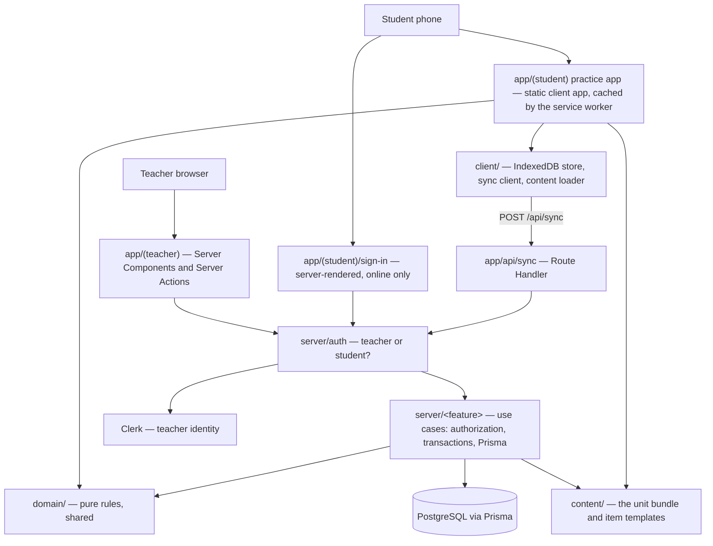
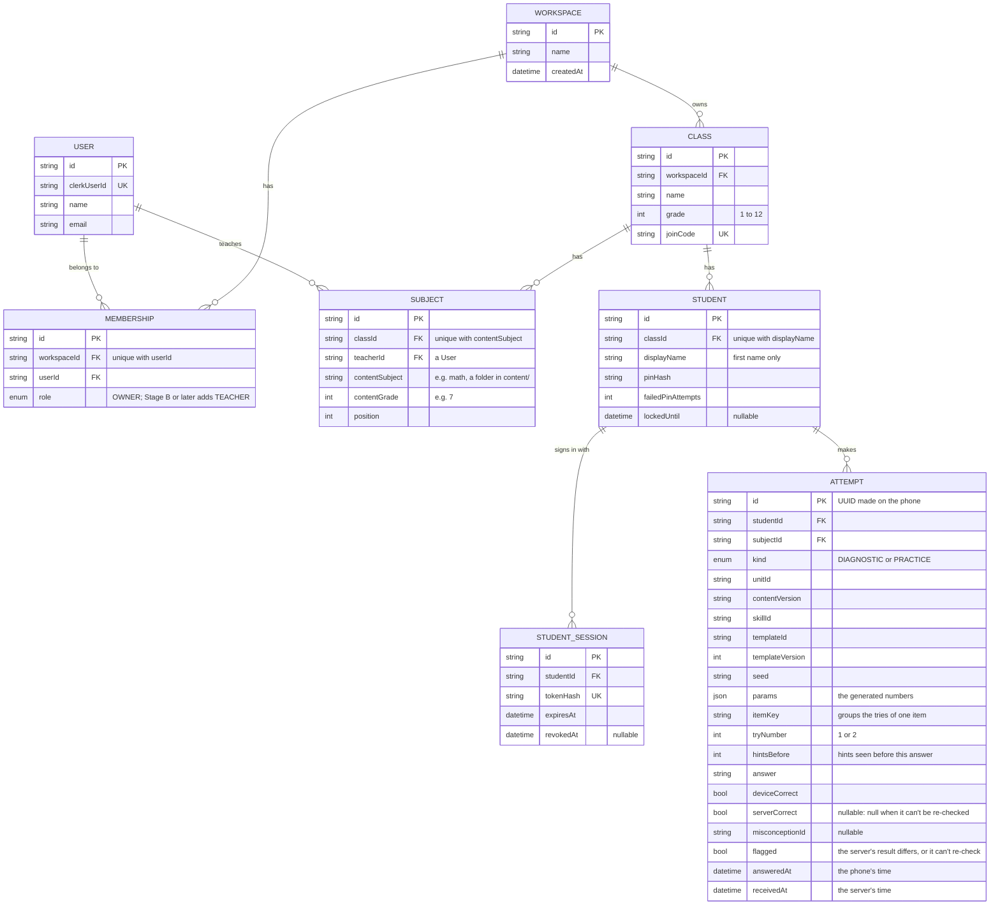

# Darsi (دَرْسي) — Architecture and Data Model

> Status: **🔄 Draft for review (v3)** · 2026-11-23
> v3 follows the Stage A strategy (PLAN.md D-24 to D-43). It replaces v2 (approved 2026-11-22), which stays in git history. Billing, calendar, demo and runtime AI parts of v2 are deferred with their features; they come back from git history when needed.
> Scope: [01-mvp-scope.md](01-mvp-scope.md) · Decisions: [../PLAN.md](../PLAN.md)

## 1. Goals that shape the architecture

1. **Rules are easy to test and run everywhere.** Answer checking, item generation, mastery, the learning path, the diagnostic and PIN lockout are pure functions with no database, network or clock inside them. The same code runs on the phone (for instant feedback offline) and on the server (to check every attempt again).
2. **No answer is lost or counted twice** (D-36, D-37). Attempts are immutable records with IDs made on the phone; sync can repeat safely.
3. **Tenant isolation can't be forgotten.** Every query is scoped by the signed-in teacher's workspace or the signed-in student, and tests try to break that.
4. **Light on low-end Android phones,** Arabic right to left from day one.
5. **Not tied to one subject or grade** (D-24). Subject, grade and unit are data; adding another one is adding content, not code.
6. **Small and boring.** One deployable app, one database, no queues or extra services.

## 2. Tech stack

| Concern | Choice | Why |
|---|---|---|
| Framework | **Next.js 16 (App Router)**, React 19, TypeScript in strict mode | The owner's core stack. Teacher pages are server-rendered; the student practice area is a static client app that works offline (section 3) |
| UI | **Tailwind CSS v4** + **shadcn/ui** (Radix primitives) | Accessible components that we own; direction-aware utility classes (`ms-*`, `pe-*`) for right to left |
| Arabic font | **IBM Plex Sans Arabic** via `next/font`, self-hosted | Clear on small screens; no request to an external font server; cached for offline use |
| Validation | **Zod**, shared by forms, Server Actions, the sync endpoint, content files, environment config and AI output | One schema per shape, checked at every boundary |
| Teacher mutations | **Server Actions** + `useActionState` | No hand-written API for teacher pages, which are online-only |
| Student sync | **One Route Handler**, `POST /api/sync` (D-36) | A cached offline copy of the app keeps old Server Action IDs after a deploy; a stable URL with a versioned payload doesn't break |
| Offline | A **service worker** and **IndexedDB**, behind small wrappers. The libraries (for example Serwist for the service worker and `idb` for IndexedDB) are chosen and recorded in the offline ADR | L1 offline (D-36) |
| Database | **PostgreSQL** + **Prisma** | Relational data with strong constraints |
| Database hosting | **Neon** (free tier in Stage A), in **Frankfurt** (`eu-central-1`) | Wakes automatically when idle; database branches for PR previews |
| Teacher login | **Clerk** (development instance in Stage A), plus an **app-level allowlist** of teacher emails (D-38, D-40) | Secure sign-in without building it. The allowlist guarantees that nobody else becomes a teacher, whatever the Clerk plan allows |
| Student login | **Our own**: class code + first name + PIN, database sessions | Children have no email (section 6) |
| AI | **Claude models through OpenRouter** (D-23), used **only by a local content-writing script** (D-29). Structured outputs, validated with Zod | Section 7 |
| Hosting | **Vercel**, functions in **Frankfurt** (`fra1`), next to the database. Hobby plan for Stage A (non-commercial) | Preview deployment for every PR |
| Error tracking | Server-side error tracking (for example **Sentry**, free tier) plus structured logs. Picked in the repo setup step. Logs never contain student names or answers (D-40) | Errors in Server Actions and sync are visible |
| Local and CI database | PostgreSQL in **Docker** | Tests run against real Postgres |
| Tests | **Vitest** (unit and integration), **Playwright** (E2E, including offline) | Testing strategy |

## 3. Architecture style: modular monolith with a shared pure core

One Next.js app with two kinds of pages:

- **Teacher pages** (`app/(teacher)`): server-rendered, online-only, mutations through Server Actions, Clerk loaded only here.
- **Student pages** (`app/(student)`):
  - **Sign-in pages** are server-rendered and online-only; they're never served from the offline cache.
  - **The practice app** (lessons, diagnostic, practice, progress) is a **static client app**. It reads the content bundle and the student's data from IndexedDB, runs the pure domain rules on the phone, and talks to the server only through `/api/sync`. The service worker caches it, so it opens and works without a connection once the student has signed in.



| Layer | Responsibility | May import | Tested with |
|---|---|---|---|
| `app/` | Pages, layouts, Server Actions, the sync Route Handler. Parse input, call one use case, render | `server/`, `client/`, `ui/` | E2E |
| `server/auth` | Resolve the actor from the Clerk session or the student cookie; apply the teacher allowlist; reject otherwise | Clerk, Prisma | Integration |
| `server/<feature>` | Use cases: permissions, transactions, the domain rules | `domain/`, `content/`, Prisma | Integration (real Postgres) |
| `client/` | Browser-only code for the practice app: IndexedDB store, per-student queues, sync client, content loading, service worker registration | `domain/`, `content/` | Unit (with a fake IndexedDB) + E2E |
| `domain/` | Pure functions: rules and calculations. Time (`now`) and randomness (a seeded generator) are passed in | Nothing with I/O | Unit (Vitest) |
| `content/` | The core content: units, skills, lessons, item templates (section 4) | `domain/` types only | Unit + property tests |

**Rules enforced by lint:** `domain/` and `content/` must not import Prisma, Next.js, Clerk, browser APIs or the AI client. `client/` must not import `server/`. Student practice pages must not use Server Actions.

### Domain modules (pure, shared by phone and server)

| Module | Responsibility |
|---|---|
| `rng` | A seeded random generator, so the same seed always produces the same item |
| `item` | The item template interface: generate an item from a seed, compute its answer, match a wrong answer to a misconception |
| `answer` | Normalize typed input (digits, minus signs, spaces) and check an answer, exactly for whole numbers and by option for multiple choice |
| `digits` | Convert Arabic-Indic, Persian and Western digits; format numbers in Arabic-Indic digits; mark negative numbers for direction isolation (D-41) |
| `feedback` | The flow for one item: tries, misconception message, hints on request, worked solution after two wrong tries (D-35) |
| `session` | Build a practice round of up to 5 items from one skill |
| `skill-map` | Check a unit's prerequisite graph (no cycles, every prerequisite exists); find the recommended next skill |
| `diagnostic` | The diagnostic's fixed set of items; which skills it passed (2 of 2) |
| `mastery` | Skill states from attempts: 4 of the last 5 first-try answers without a hint, or passed in the diagnostic with no wrong attempt since (D-34) |
| `attempt` | The attempt record's shape and the rules derived from it (counts for mastery, unmatched wrong answer) |
| `pin` | Lockout after 5 failures for 15 minutes; reset on success |
| `join-code` | Class codes from an alphabet without look-alike characters; case-insensitive matching |

## 4. Content model (D-26, D-27, D-39)

Content lives in the repo, under `content/`, and is never stored in the database.

```
content/
├─ LICENSE.md                         all rights reserved (D-39)
└─ math/                              subject
   └─ grade-7/                        grade
      └─ integers/                    unit
         ├─ unit.ts                   id, title, version, skills in order, diagnostic plan
         ├─ skills/<skill-id>/
         │  ├─ lesson.md              objective, explanation, worked examples, quick check
         │  └─ templates.ts           item templates with their misconceptions, hints and worked solutions
         └─ assets/                   static pictures such as the number line (SVG)
```

- **Subject, grade and unit are folders and data,** not code paths. Nothing outside `content/` names math or grade 7 (D-24).
- **Lessons** are Markdown with a small allowed syntax (paragraphs, bold, lists, numbers, pictures). The build turns them into JSON, so the phone doesn't need a Markdown parser.
- **An item template** has an ID, a version, a skill, an answer type (whole number or multiple choice), a generator that turns a seed into the numbers and the question, the answer, the misconceptions (wrong-answer patterns with message IDs), two hints and a worked solution. All Arabic text sits next to the logic it explains.
- **Review state:** every AI-drafted text carries `reviewed: false` until the owner reviews it. CI fails if a published unit contains unreviewed text (D-08b).
- **Versions:**
  - The unit's **content version** is a hash computed by the build. Every attempt stores it.
  - A template's **version** goes up whenever its generator or answer logic changes. The server can only re-check an attempt made with the template version it currently has (section 5).
- **The unit bundle:** the build produces one JSON file per unit (lessons and texts) with its content version. The templates' code is bundled into the practice app's JavaScript. The service worker caches both.
- **Checks in CI:** every file matches its Zod schema; the skill map has no cycles; each template generates thousands of items from random seeds, and each answer is checked against an independent calculation (property tests).

## 5. Data model

The database holds identity, classes, students and attempts. Content stays in files (section 4). Billing, calendar and AI-usage tables from v2 are deferred with their features (D-32, D-29).



### Tables

| Table | Key fields | Notes |
|---|---|---|
| `User` | `clerkUserId` (unique), `name`, `email` | A copy of the Clerk identity, created on first sign-in **only if the email is on the teacher allowlist** |
| `Workspace` | `name`, `createdAt` | The tenant. No trial field in Stage A (D-07 deferred) |
| `Membership` | `workspaceId`, `userId`, `role` | Unique per workspace and user. Stage A has only `OWNER` (D-13) |
| `Class` | `workspaceId`, `name`, `grade` (1–12), `joinCode` (unique) | A group of children (D-22) |
| `Subject` | `classId`, `teacherId`, `contentSubject`, `contentGrade`, `position` | One subject taught to a class, pointing to a subject and grade folder in `content/`. Unique per class and content subject |
| `Student` | `classId`, `displayName`, `pinHash`, `failedPinAttempts`, `lockedUntil` | Unique per class and name. First name only (D-40) |
| `StudentSession` | `studentId`, `tokenHash` (unique), `expiresAt`, `revokedAt` | The cookie's token is looked up by its hash. Revoked when the teacher resets the PIN |
| `Attempt` | see the diagram | **One record per answer** (each try), never changed (D-37). The phone makes its ID, so a repeated sync inserts it once (`ON CONFLICT DO NOTHING`). A database trigger rejects every `UPDATE`. Mastery counts only `tryNumber = 1` and `hintsBefore = 0`. Indexed by student, skill and time |

### Data rules

- **IDs** are random strings (cuid2) for server-made rows and UUIDs made on the phone for attempts; never sequential numbers in URLs.
- **Attempts are immutable.** The only way to remove them is deleting the student, which deletes the student's sessions and attempts in one transaction (D-40).
- **Re-checking:** the server re-generates the item from the template, its version and the seed, compares the stored parameters, and checks the answer. If the template version is no longer the current one, it stores `serverCorrect = null` and flags the attempt.
- Constraints Prisma can't express (the `UPDATE` trigger, check constraints such as `tryNumber IN (1, 2)`) live in **hand-written SQL migrations**, each with a test.

## 6. Key flows

**Teacher first sign-in.** Clerk signs the owner in. On the first request, `server/auth` checks the email against the allowlist in server configuration; anyone else gets a "not allowed" page and nothing is created. `ensureWorkspace()` then creates `User`, `Workspace` and `Membership` in one transaction; the unique `clerkUserId` stops duplicates from two simultaneous requests.

**Student sign-in** (online only).
1. The student enters the class code; the server shows the class's first names.
2. The student picks a name and enters the PIN on Darsi's keypad; `pin` decides whether the student is locked out.
3. The server checks the PIN hash, creates a `StudentSession`, and sets a secure HTTP-only cookie with a random token (only its hash is stored).
4. The page stores the current student (ID, first name, class, subject) in IndexedDB and opens the practice app.

**Practising, online or offline.**
1. The practice app loads the unit bundle and the student's attempts from IndexedDB, and computes skill states with `mastery`.
2. A session generates up to 5 items from the chosen skill's templates, each from a new seed.
3. Each answer is checked on the phone and immediately saved as an attempt in that student's queue in IndexedDB. Feedback follows `feedback`.
4. The progress screen reads the same attempts, so it's correct offline too.

**Sync** (`POST /api/sync`), started when the app opens, when the connection returns, and after each session.
1. The phone sends the current student's queued attempts (up to a fixed batch size) and the time of the last attempt it already has from the server.
2. The server checks the session cookie and the request's origin, rejects attempts whose student isn't the signed-in one, and validates each attempt with Zod.
3. For each attempt: re-check it, then insert it once. A difference between the phone and the server sets `flagged`.
4. The server answers with the IDs it stored and with the student's attempts the phone doesn't have yet (for example, after signing in on a new phone).
5. The phone removes the stored IDs from the queue and saves the attempts it received. The sync state on screen updates.

A `401` (expired or revoked session) keeps the queue and asks the student to sign in again.

**Switching student.** The current student is signed out (on the server too, when online). That student's queue stays on the phone and is sent the next time that student signs in with a connection (D-38). The sign-in screen shows each student's waiting count. The app never shows one student's progress to another.

**Deleting a student.** One transaction deletes the student's attempts, sessions and the student. A phone that still has the student's queue gets "not found" on sync and clears it.

## 7. AI for writing content (D-29, D-30)

- **Only a local script** (`scripts/content-ai/`) calls AI. It is run by hand, never in CI, never by the app, and costs money, so it runs only after the owner agrees (D-23).
- **Input:** a template's definition (skill, sample generated items, the expected misconceptions). Its input type can't hold student data (D-08a) or UNRWA text (D-26). From Stage C on, it may also take anonymous wrong-answer patterns from more than one student (D-30).
- **Output:** drafts of misconception messages, two hints and a worked solution per template, in Arabic, as structured output validated with Zod. They're written into the content files with `reviewed: false`.
- **Review:** the owner edits and marks each text reviewed; CI blocks unreviewed text in a published unit (D-08b).
- **Model:** Claude Opus 5.5, Sonnet 5.5 or Haiku 5.5 through OpenRouter, pinned to Anthropic as the serving provider (D-23). The owner picks after a small trial on a few skills (Q-15), recorded in an ADR. A credit limit on the OpenRouter key bounds the spending (D-21).

## 8. Security

| Area | Approach |
|---|---|
| Teacher | Clerk session **plus** the email allowlist in server configuration (D-38, D-40) |
| Students | Random session token in an HTTP-only, Secure, SameSite cookie; only its hash is stored; revoked on PIN reset |
| PINs | Hashed, with 5 tries every 15 minutes. **A 4-digit PIN is weak:** across a class of 30 a guess on some student succeeds in under a day, and anyone with the class code can lock students out. Accepted for Stages A and B (a secret class code, one child, synthetic data); reviewed before Stage C (D-38) |
| Sync endpoint | Session required; the request's origin must be Darsi's; attempts must belong to the signed-in student; strict Zod validation; a maximum batch size and body size |
| Authorization | Use cases never trust IDs from the browser. The workspace or student comes from the session, and every query is scoped by it |
| Tenant isolation | App-level scoping plus integration tests that try to read and change another tenant's data |
| Data on a shared phone | Each student's queue and data on the phone are kept separately and never shown to another student. Someone with the phone and developer tools could read them; accepted for first names and answers (D-38) |
| Children's data | First names only; no student data in logs, screenshots or AI prompts (D-40, D-30) |
| Secrets | Environment variables only; `.env.example` has placeholders |

## 9. Time, digits and language

- **Time:** timestamps are stored in UTC. Reports that count "days" use Palestine time (`Asia/Hebron`).
- **Language:** Arabic only, right to left. `<html lang="ar" dir="rtl">`, direction-aware Tailwind classes. All UI text lives in one Arabic messages file.
- **Displayed digits:** Arabic-Indic (١٢٣), as in the UNRWA cards (D-41).
- **Negative numbers:** shown as "-٥" inside a direction-isolated element, so a right-to-left page never shows "٥-". A shared UI component is the only way to print a number, and a test checks its output.
- **Typed digits:** Darsi's keypad types Arabic-Indic digits. PINs, class codes and answers also accept Persian and Western digits, converted before checking.

## 10. Performance on low-end phones

- Teacher pages: Server Components by default.
- The practice app is client code by nature. It stays small: no state-management, charting or rich-text libraries; content arrives as a compact JSON bundle.
- **Target:** the practice app under **~200 KB of compressed JavaScript** on first load, checked with Lighthouse in the practice PR. After that, everything comes from the cache.
- **Clerk only on teacher pages,** never in student pages.

## 11. Environments

| Environment | App | Database | AI |
|---|---|---|---|
| Local | `next dev` (the service worker is tested with a production build) | Postgres in Docker | Only the content script, by hand |
| CI | GitHub Actions | Postgres service container, migrated and seeded with synthetic data | None |
| PR preview | Vercel preview deployment | A Neon database branch per preview, seeded with synthetic data; **never the Stage A database** | None |
| Stage A | A private Vercel deployment (Hobby, non-commercial), Clerk development instance, teacher allowlist with the owner's email | Neon main branch, holding the family test's data (D-40) | None |

**Region:** Neon in Frankfurt (`eu-central-1`) and Vercel functions in `fra1`, so the app and the database sit in the same city.

Migrations run in the Vercel build (`prisma migrate deploy`). From Stage A on, the database holds real data, so migrations must be backward compatible: add first, remove in a later PR.

## 12. Ready for Stage B, C and later

| Later need | Why the Stage A design already fits |
|---|---|
| Teacher dashboard and skill gaps (Stage B) | The server already has every attempt, and `mastery` runs on the server too, so a class view is a new query and page |
| Teacher intervention (Stage B) | A new table (for example a skill assigned to a student) read by the practice app's learning path |
| Synthetic data for Stage B | A seed script that creates attempts through the same domain rules |
| Several teachers per school | `Membership.role` gets `TEACHER`; `Subject.teacherId` already separates the owner from each subject's teacher (D-13, D-22) |
| More units, subjects and grades | New folders in `content/`; a class gets more subjects (D-24) |
| Runtime AI tutor | Hint levels, misconception IDs and worked solutions already have their own shape; a runtime provider can fill the same shape (D-29) |
| Full offline (L2) | Immutable attempts, per-student queues and versioned content bundles are what L2 builds on (D-36) |
| Stage C privacy work | Deleting a student already exists; export reads the same tables |
| Payments | The v2 billing design (calendar, notices, subscriptions) is in git history, waiting for the business model (D-32) |

## 13. Decisions that become ADRs

| ADR | Decision |
|---|---|
| 001 | Record architecture decisions as ADRs |
| 002 | Modular monolith on Next.js with a pure domain layer shared by the phone and the server (dependency rules enforced by lint) |
| 003 | PostgreSQL + Prisma, hosted on Neon in Frankfurt next to Vercel's functions |
| 004 | Clerk for the teacher, plus an app-level email allowlist |
| 005 | Student login with class code, name and PIN; database sessions; the PIN's weakness accepted until Stage C |
| 006 | Tenant isolation by app-level scoping, proven by isolation tests |
| 007 | Content as files: format, build, unit bundle, versions, review state, content license |
| 008 | AI only in the content-writing script, through OpenRouter, with human review |
| 009 | AI model choice, from the small trial |
| 010 | Arabic right to left first; all UI text in one messages file |
| 011 | Digits and negative numbers: Arabic-Indic display, isolated direction, normalized input |
| 012 | License: FSL-1.1-ALv2 for the code (D-17) |
| 013 | Limited offline (L1): service worker, caching rules, IndexedDB and per-student queues |
| 014 | A class is a group of children; subjects point to content (D-22) |
| 015 | Immutable attempts, the sync protocol and the server's re-check |
| 016 | The skill map and the mastery rule |

## 14. Risks to check early

| Risk | Check | Fallback |
|---|---|---|
| The service worker library may not fit Next.js 16's App Router well | A spike in the offline PR: cache the practice app, open it in airplane mode | A small hand-written service worker for the practice app only |
| The browser may clear IndexedDB under storage pressure | Check `navigator.storage.persist()` on the son's phone; sync often | The server keeps everything already synced; only unsynced answers are at risk, and the sync state shows them |
| Negative numbers and Arabic-Indic digits may display wrongly in Chrome on Android | Test the number component on the real phone early | Adjust the isolation markup |
| Clerk's screens may not look right in Arabic right to left | Verify in the auth PR | Our own sign-in form using Clerk's hooks |
| Clerk may not offer sign-up restrictions on the free plan | Verify in the auth PR | The app-level allowlist already guarantees it |
| Writing the content takes longer than planned | Write one complete skill first and time it | Fewer templates per skill (scope cut line) |
| The database sleeping makes the first page slow | Check cold-start time | Neon's minimum compute setting |
